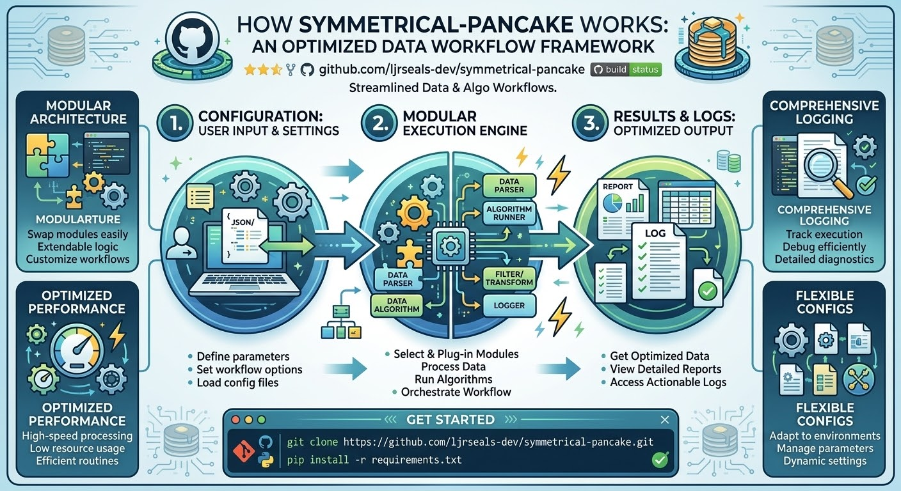

Copyright © 2026 Lewis James Seals Jr. All rights reserved.
THE SOFTWARE IS PROVIDED "AS IS", WITHOUT WARRANTY OF ANY KIND,
EXPRESS OR IMPLIED, INCLUDING BUT NOT LIMITED TO THE WARRANTIES OF
MERCHANTABILITY, FITNESS FOR A PARTICULAR PURPOSE AND
NONINFRINGEMENT.
# symmetrical-pancake 🥞

[](https://opensource.org/licenses/MIT)
[](https://www.python.org/)
[]()

> A robust, efficient, and neatly stacked utility designed to streamline modern data processing and algorithmic workflows.

---

## 📖 Overview

**symmetrical-pancake** is a high-performance repository built to handle complex operational logic with elegance and speed. Inspired by clean architectural patterns and reliable execution pipelines, this project provides a modular framework for developers looking to optimize their workflow.

---

## 📊 How It Works: Architecture & Workflow

The system is structured around a three-stage execution pipeline designed for seamless configurability, low latency, and comprehensive auditability.

[span_0](start_span)[span_0](end_span)

### Core Architectural Phases

1. **Configuration & Settings (Stage 1)**
   * **User Input & Config Loading:** Ingests parameters, execution rules, and workflow options via structured JSON configuration files (`config/default.json`).
   * **Environment Prep:** Validates runtime parameters before handing control over to the core engine.

2. **Modular Execution Engine (Stage 2)**
   * **Data Parser:** Efficiently ingests and structures incoming raw datasets.
   * **Algorithm Runner:** Executes core compute routines, data processing logic, and algorithmic pipelines.
   * **Filter & Transform:** Applies modular transformations to optimize performance and data integrity.
   * **Internal Logger:** Captures runtime metrics and state changes in real-time.

3. **Results & Diagnostic Logging (Stage 3)**
   * **Optimized Output Generation:** Produces structured reports and cleaned data artifacts.
   * **Comprehensive Trace Logging:** Dumps detailed diagnostics to facilitate debugging, profiling, and compliance tracking.

---

## ✨ Key Technical Features

* **Modular Architecture:** Easily plug in custom extensions, parsing modules, or algorithm runners without altering core pipeline logic.
* **Optimized Performance:** Built with lightweight routines and low resource overhead to ensure high-speed processing.
* **Comprehensive Logging:** Built-in tracking and diagnostic logging for seamless debugging, monitoring, and verification.
* **Flexible Configurations:** Dynamic parameter management tailored for diverse target environments.

---

## 🚀 Getting Started

### Prerequisites

Ensure you have the following installed on your local environment:
* Python 3.8+ (or your primary runtime environment)
* Git

### Installation

1. **Clone the repository:**
   ```bash
   git clone [https://github.com/ljrseals-dev/symmetrical-pancake.git](https://github.com/ljrseals-dev/symmetrical-pancake.git)
   cd symmetrical-pancake


   ```
## 💻 Usage
To run the primary execution pipeline with a target configuration:
```bash
python main.py --config config/default.json

```
For detailed options and advanced performance tuning, check the documentation files within the repository.
## 🤝 Contributing
Contributions, issues, and feature requests are welcome! Feel free to check the issues page.
 1. Fork the Project
 2. Create your Feature Branch (git checkout -b feature/AmazingFeature)
 3. Commit your Changes (git commit -m 'Add some AmazingFeature')
 4. Push to the Branch (git push origin feature/AmazingFeature)
 5. Open a Pull Request
## 📝 License
Distributed under the MIT License. See LICENSE for more information.
```

```
